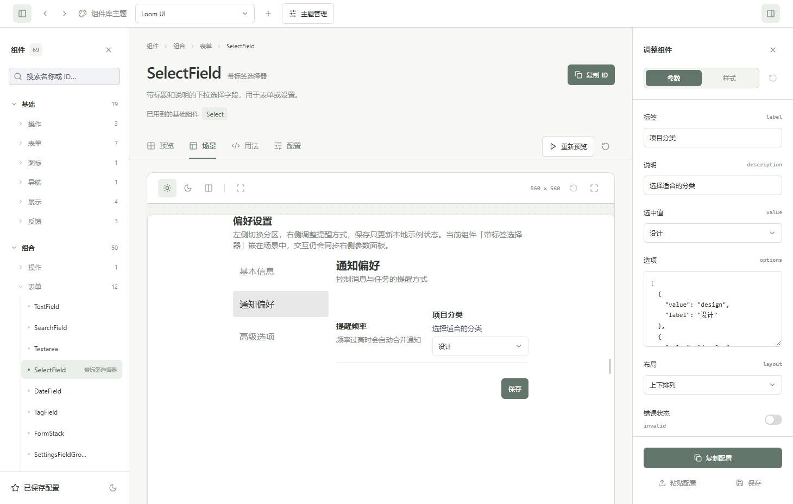

<div align="center">
  
  <h1>Moduloom</h1>
  <p>React 组件库的浏览器工作台。</p>
  <p><a href="#运行示例">运行示例</a> &nbsp;&nbsp; <a href="frame/README.md">接入指南</a></p>
</div>

## 功能

- 在独立预览或组合场景中运行组件。
- 在参数面板修改属性，当场看到结果。
- 对照深浅主题，复制组件参数和配置。

## 界面展示



## 运行示例

需要 Node.js 22.18+ 和 pnpm 11。

```sh
git clone --recurse-submodules https://github.com/Moduloom/moduloom.git
cd moduloom
pnpm install --frozen-lockfile
pnpm demo
```

打开 [本地工作台](http://127.0.0.1:4321/)。示例里的按钮支持调整文字和禁用状态。

接入自己的组件库时，在 `frame.config.ts` 注册组件清单和渲染器，再运行 `pnpm dev`。配置示例见 [接入指南](frame/README.md)。

## 相关项目

工作台使用 [Loom UI](https://github.com/Moduloom/loom-ui)。完整产品界面的预览示例见 [BetterGI Web UI](https://github.com/Moduloom/bettergi-web-ui)。

## 许可证

[GPL v3](LICENSE)
